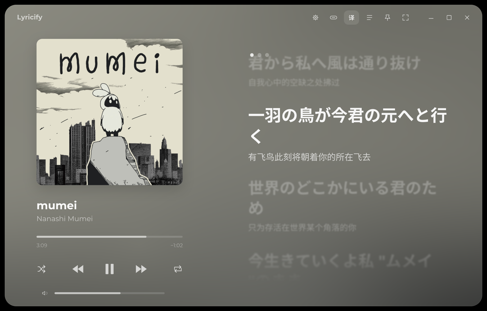

# Lyricify Island

**该项目由 AI 编写**

https://github.com/user-attachments/assets/bc65054e-03d4-4007-9032-1123cf56aa45

Linux 桌面歌词岛。当前曲目和播放进度可来自 Spotify Web API 或本机 MPRIS；逐字歌词与翻译通过
[Lyricify Lyrics Helper](https://github.com/WXRIW/Lyricify-Lyrics-Helper) 获取和解析。
字体、逐字裁剪、双层微光、播放头 bloom 与换行动画都在 Skia 自绘层完成，正常桌面运行时由 GPU 渲染。



## Fedora 安装

Fedora 43、44 和 45 的 x86_64 系统可以从 [COPR 仓库](https://copr.fedorainfracloud.org/coprs/xiaozhangup/LyricifyIsland/)安装：

```bash
sudo dnf copr enable xiaozhangup/LyricifyIsland
sudo dnf install lyricify-island
```

安装后可从应用菜单启动 Lyricify Island，也可运行 `LyricifyIsland`。RPM 使用系统的 .NET 运行时和 OpenCC；仓库会在 GitHub 的 main 分支推送后重新构建。

## 首次运行

1. 在 [Spotify Developer Dashboard](https://developer.spotify.com/dashboard) 的应用设置中加入回调地址：
   `http://127.0.0.1:43821/callback`。
2. 安装 RPM 后从应用菜单启动，或从源码构建并启动：

   ```bash
   ./build.sh
   ./run.sh
   ```
3. 岛屿提示未配置时，打开托盘菜单的“设置”，填写 Spotify Client ID 和
   Client Secret，然后点击“保存并重新连接”。

也可以在设置中把“播放信息源”切换为“本地 MPRIS”，直接读取本机播放器，无需 Spotify 参数或授权。

Spotify 模式首次授权时会打开浏览器，请登录并允许读取当前播放状态。刷新令牌只保存在当前用户的状态目录，
凭据只保存在当前用户的设置文件中；凭据、令牌、构建缓存和发布目录都不会进入 Git。
发布物 `dist/LyricifyIsland` 是单个可执行文件，自带 .NET 运行时和原生库，启动不要求系统安装 .NET。

Spotify 开发模式下，还需要在 Dashboard 中把登录所用 Spotify 账号加入应用用户列表。
程序启动后常驻系统托盘；托盘菜单提供“打开歌词窗口”“收藏歌曲”“显示词岛”开关、
“耳机控制”“降噪模式”“设置”和“退出”。Spotify 当前歌曲已收藏时，同一项切换为“取消收藏歌曲”；
切换为非 Spotify 音源时隐藏收藏项。
黑色岛屿区域支持滚轮向上切到上一首、向下切到下一首，单击暂停 / 恢复播放。
滚轮切歌时先轻移、淡化旧内容，收到新歌后用约 280 ms 纵向滑入；上滚向下退出、从上方进入，下滚方向相反。
等待播放器响应时保留旧歌词，切歌失败或歌曲未变化时平滑还原。
通过岛屿单击暂停时，歌词继续保留，两侧图标淡出并收窄岛屿。
暂停时歌词高亮和光晕一起渐变为普通文字，中间所有文字（歌词、翻译、歌名、歌手及状态提示）和岛屿高度同步缩小 20%；恢复播放后渐变还原并展开。
按住左键拖动、左键双击临时隐藏，区域外保持鼠标穿透；
右键菜单也可临时隐藏、调整当前歌曲偏移或退出。隐藏时长和拖动行为都可在设置中调整。
右键选择“复制歌曲分享图…”进入主窗口的歌曲分享图页面，也可以在主窗口的页面导航中切换。分享图与设置、耳机控制共用窗口、封面配色和切换动画。选好横竖版和要显示的内容，再点击“复制图片”即可粘贴。
横版宽 2560 像素，竖版宽 2160 像素，高度随内容调整；预览旁会显示复制图片的实际尺寸。
图片保留圆角、阴影和透明留边。粘贴后的透明效果取决于接收应用。

每次进入分享图页面时读取当前歌曲，歌词默认选中此时正在播放的那一句，也可以另选或关闭；歌词翻译沿用软件设置。
软件名默认不显示。Spotify 在线歌曲可选择显示二维码，扫码即可打开歌曲；
二维码位于歌曲信息右侧，MPRIS 音源和 Spotify 本地文件不提供二维码。
关闭二维码后，歌曲信息会占满可用宽度；关闭歌词或软件名后，图片会收起多余的空白。

预览窗口始终展示打开时的歌曲，不随播放器切歌。
窗口打开后会重新加载封面，复制时会等待加载完成，并优先使用分辨率较高的版本。
加载失败时会提示使用缓存封面。

## 歌词窗口

点击托盘图标，或在托盘 / 歌词岛右键菜单选择“打开歌词窗口”。也可以用
`./run.sh --lyrics-window` 启动时直接打开。

界面参考 [Lyricify 的 Apple Music Sing 演示](https://www.bilibili.com/video/BV1bK41167Q4/)。
窗口关闭系统标题栏和边框，圆角、阴影、标题栏按钮、封面、播放控件和歌词都由 Skia 绘制。
最大化时去掉窗口圆角、阴影和外侧留边，背景铺满桌面可用区域；全屏时铺满整个屏幕，恢复普通窗口后重新显示圆角。
左侧封面、歌曲信息和播放控件随窗口宽高调整大小，右侧显示滚动歌词；缩小窗口后自动切换为上下布局。
背景从封面取色，切歌时平滑交叉淡化；按钮悬浮、按下、开关和禁用恢复状态也带淡入淡出。
进入和退出纯歌词模式时，封面淡入淡出，歌词区域和播放控件平滑移动，换行变化通过淡化衔接。
歌词逐行弹性滚动，远处的歌词模糊淡出。逐字歌词按真实时间戳渐亮，
长音轻微上浮；只有逐行时间戳的歌词整行点亮。
阴影和可见的静止歌词按屏幕缩放缓存，减少重复模糊与离屏合成；缓存随内容、尺寸或缩放更新，
滚动、逐字高亮和交互动画仍实时绘制，保留原有刷新率和效果。

- 拖动标题栏或封面移动窗口，拖动边缘缩放，双击标题栏切换最大化。
- 滚轮或拖动歌词浏览，停止操作 5 秒后恢复跟随，也可点击“回到当前歌词”。
- 点击歌词跳到对应时间；进度条和音量条支持拖动。
- 播放 / 暂停、上一首、下一首、随机和循环控制当前音源，不支持的操作会变灰。
- 歌曲信息右侧的收藏按钮可将 Spotify 当前歌曲加入「喜欢的歌曲」，再次点击可取消收藏；未收藏为白色圆圈加号，已收藏为白色圆形，中央勾号镂空透出背景。
  收藏图标位于歌名与歌手信息右侧的竖直居中位置，图标自身的右边缘与专辑封面右边缘对齐；纯歌词模式下移到播放控件旁。按钮平时无额外底色，悬浮和按下时显示轻微高亮。
  切歌时读取收藏状态，状态未知时点击只会添加收藏。MPRIS、本地文件和非歌曲内容不支持此操作，按钮会变灰。
- 顶栏可切换翻译、纯歌词、灵动岛显示和全屏，并打开设置。
  灵动岛开关会保存，重启后继续生效；翻译与歌词偏移和歌词岛共用。
- 空格播放 / 暂停，左右方向键快退 / 快进 5 秒，上下方向键浏览歌词，Home 恢复跟随，
  T 切换翻译，Ctrl+L 切换纯歌词，F11 切换全屏。Esc 依次退出全屏、恢复跟随或关闭歌词窗口。

关闭歌词窗口后程序仍在托盘运行。MPRIS 直接控制当前选中的本地播放器。
Spotify 播放控制使用官方 API，需要 Premium 与 `user-modify-playback-state` 权限；
旧版本的只读授权在首次点击播放控件时会打开浏览器申请新增权限，单纯显示歌词不触发重新授权。
相关限制见 [Spotify 播放控制文档](https://developer.spotify.com/documentation/web-api/reference/start-a-users-playback)。
收藏使用 `user-library-read` 和 `user-library-modify` 权限；旧账号首次点击收藏按钮时会打开浏览器补充授权，
授权期间切歌后需要重新点击。收藏通过 [Spotify Library API](https://developer.spotify.com/documentation/web-api/reference/save-library-items)
同步到账户，操作成功后才更新收藏图标状态。

## 耳机控制

从托盘右键菜单打开“耳机控制”，也可以用 `./run.sh --headphones` 启动时直接打开。
先在系统蓝牙设置中配对并连接华为、OPPO、OnePlus 或 realme 耳机。应用默认监听系统蓝牙连接变化，
按型号和控制服务识别兼容耳机，自动建立控制连接；启动时已连接的耳机也会自动接入。
歌词主界面右上角按钮组会显示耳机图标，鼠标悬停时向左展开名称和左右耳、充电盒电量，
继续移到展开区左侧可显示“关闭 / 降噪 / 通透”图标按钮，悬停图标可查看名称；
离开左侧操作区后收起快捷项，耳机信息仍按原有悬停方式展开或收起。
大小窗口使用相同的图标尺寸与间距；窗口较窄时截短设备文字，为快捷操作保留空间。
点击耳机图标或设备信息可打开耳机控制，断开后自动隐藏。
关闭耳机窗口后服务继续运行，退出应用时释放连接。

窗口沿用设置页的深色卡片、字体和绿色选中态。功能按识别到的型号和耳机回传能力显示：

- 左耳、右耳和充电盒电量，以及充电、佩戴状态。
- 降噪、通透、关闭和自适应模式；支持的型号可调整智能、深度、中度和轻度降噪。
- EQ 预设、空间音频或空间音效、游戏模式和游戏音效。
- 佩戴检测、双设备连接和连接设备列表；支持的型号还可设置音频优先设备或恢复自动选择。
- 固件版本和音频编解码信息。支持回读的功能在操作后读取实际状态，尚未收到的状态显示为未知。

托盘的“降噪模式”菜单可以直接切换耳机支持的模式，处于降噪模式时才显示强度选项；
选中状态随耳机回报更新，未连接时禁用。

连接使用 Linux BlueZ 和 Bluetooth Classic RFCOMM。默认通过服务 UUID 查找控制通道，
OPPO 系耳机也提供固定通道 15 的连接选项；华为耳机使用标准 SPP 服务，不使用通道 15。
仅需系统蓝牙服务，无需 root 或另装 Android 模块。
可在耳机窗口关闭“蓝牙耳机连接后自动接入”，也可手动选择设备连接。主动断开控制后，本次蓝牙连接期间不会自动连回；
下次系统蓝牙重新连接耳机时会再次自动接入。控制选项保存在
`$XDG_CONFIG_HOME/lyricify-island/headphones.json`（默认 `~/.config/lyricify-island/headphones.json`）。

连接和协议参考 [OppoPodsManager](https://github.com/Zhaoyi-ya/OppoPodsManager) 与
[OppoPods](https://github.com/Leaf-lsgtky/OppoPods)。内置 137 条机型数据，实际功能取决于耳机型号、
固件及其状态回报；这不代表每款耳机均已实机验证。数据来源、固定提交和许可见
[第三方说明](THIRD_PARTY_NOTICES.md)。

### 华为耳机

华为协议参考 [HuaweiPods](https://github.com/Nshpiter/HuaweiPods)。已接入以下 16 个型号的识别与相应控制，
按型号显示可用选项。当前已通过构建、原有自检和耳机窗口启动检查，尚未用华为耳机实测。

| 型号 | 当前接入功能 |
| --- | --- |
| FreeBuds 3 | 降噪 / 关闭指令；暂不支持电量与降噪状态回读 |
| FreeBuds 4E | 电量、降噪 / 关闭、两档降噪、佩戴检测、3 种音效 |
| FreeBuds 5 | 电量、降噪 / 关闭、三档降噪、佩戴检测、4 种音效、低时延 |
| FreeBuds 5i / 6i | 电量、降噪 / 通透 / 关闭、四档降噪、佩戴检测、4 种音效、低时延 |
| FreeBuds SE 4 ANC | 电量、降噪 / 通透 / 关闭、三档降噪、4 种音效、低时延 |
| FreeBuds Pro 3 | 电量、降噪 / 通透 / 关闭、四档降噪、佩戴检测、低时延 |
| FreeBuds Pro 4 | 电量、降噪 / 关闭指令；暂不支持降噪状态回读 |
| FreeBuds Pro 5 | 电量、降噪 / 通透 / 关闭、四档降噪、佩戴检测、9 种音效、空间音频、双设备开关、低时延 |
| FreeBuds 7i | 电量、降噪 / 通透 / 关闭、四档降噪、佩戴检测、4 种音效、空间音频、低时延 |
| FreeClip | 左右耳与充电盒电量 |
| FreeClip 2 | 电量、佩戴检测、4 种音效、空间音频、低时延 |
| FreeArc | 电量、5 种音效 |
| 华为智能眼镜第一代 / Eyewear 3 | 左右镜腿电量 |
| Eyewear 2 | 左右镜腿电量、低时延 |

改过名字的耳机可以在设备列表中手动连接，程序会尝试读取协议型号；也可以在断开控制连接后，
从“连接偏好 → 设备型号”选择真实型号，选择结果按蓝牙地址保存。若设备返回可验证的型号标识，
以该标识为准。只有通用 SPP 音频服务、尚未识别型号的设备不会自动连接。

FreeBuds 3 与 Pro 4 的降噪操作仅提示指令已发送，不显示未经回读确认的选中态。
华为低时延功能没有可靠的状态回读，开关显示本次连接最近发送的设置，重连后恢复为“未设置”。
FreeClip、FreeArc 和眼镜不显示降噪选项；眼镜只显示左右镜腿电量。
当前没有移植 HuaweiPods 的手势设置、自定义均衡器编辑、设备图片和 HyperOS 系统集成。

## 本地验收

无需 Spotify 即可查看内置的参考动效：

```bash
./run.sh --demo
./run.sh --demo --lyrics-window
./dist/LyricifyIsland --self-test
./dist/LyricifyIsland --snapshot /tmp/lyricify-island.png
./dist/LyricifyIsland --snapshot /tmp/lyricify-lyrics-window.png --lyrics-window
./dist/LyricifyIsland --snapshot /tmp/banner-wide.png --banner
./dist/LyricifyIsland --snapshot /tmp/banner-tall.png --banner --portrait
```

`--demo --exit-after 5` 可用于五秒启动冒烟检查。

## 调整

托盘菜单的“设置”页面提供：

- 整体缩放：50%–200%，默认 100%，同步缩放字体、图标、胶囊、间距和光效。
- 最大宽度：按可用显示器的宽度计算，范围为 40%–100%，默认 70%。
- 背景不透明度：35%–95%；歌词翻译也可以单独关闭。
- 背景模糊：对支持 `ext-background-effect-v1` 的 Wayland 合成器生效，包括 GNOME 51 的 Mutter；开关立即生效。
- 最大刷新率：限制歌词窗口和灵动岛动画的刷新频率，可选 30–360 FPS 或“无限制”。
- 垂直同步：在 EGL 支持时调整交换间隔；自适应模式不受支持时使用普通垂直同步。最终显示节奏由 Wayland 合成器控制。
- 歌词时间偏移：全局偏移范围为 -2000–2000 毫秒，正值提前、负值延后。
- 每首歌曲偏移：可单独开关；启用后从灵动岛右键菜单调整当前歌曲，并在设置页管理已保存歌曲。
- 歌词源：可选自动、网易云、酷狗或 LRCLIB；也可重新获取当前歌曲。
- 交互：锁定拖动或让整个窗口穿透鼠标。
- 暂停行为：立即隐藏、3 秒后隐藏或保持显示；通过岛屿单击暂停时始终保留并收窄，连接和错误提示不会被隐藏。
- 临时隐藏：可选 2、5、10 或 30 秒。
- 登录后自动启动：写入当前用户的 XDG 自启动目录。
- 播放信息源：可在 Spotify Web API 与本地 MPRIS 之间切换。
- Spotify Client ID 和 Client Secret：点击保存后重新连接，Secret 在界面中遮蔽显示。
- 缓存：显示歌词、封面和歌曲信息缓存占用，并可一键清理。

设置保存在 `$XDG_CONFIG_HOME/lyricify-island/settings.json`；未设置 `XDG_CONFIG_HOME` 时使用
`~/.config/lyricify-island/settings.json`。Linux 下设置目录权限为 `0700`，文件权限为 `0600`。
歌曲缓存保存在 `$XDG_CACHE_HOME/lyricify-island/tracks`；未设置时使用 `~/.cache`。

当前曲目加载完成后，后台预取相邻曲目的歌词、封面和可用的 Spotify 歌手图片；每次只加载一首，
切歌时取消旧任务并更新范围，同一首播放期间每 30 秒检查一次队列。已缓存内容直接复用，切换歌词源时重新获取对应歌词。
Spotify 从 [待播队列](https://developer.spotify.com/documentation/web-api/reference/get-queue) 选取后 5 首，
向前最多 5 首结合本次已播放曲目和 [最近播放记录](https://developer.spotify.com/documentation/web-api/reference/get-recently-played) 获取。
最近播放记录需要 `user-read-recently-played` 权限；旧授权可在设置中点击“保存并重新连接”补充授权，
未补充时仍可预取后续歌曲并复用本次已播放的缓存。最近播放记录不保证与“上一首”的实际顺序一致。
MPRIS 使用播放器提供的 [TrackList](https://specifications.freedesktop.org/mpris/latest/Track_List_Interface.html)
获取当前曲目前后各 5 首；未提供该接口的播放器只能缓存实际播放过的曲目。

以下环境变量只用于旧配置迁移：对应字段还没有写入设置文件时才会读取。

- `LYRICIFY_OFFSET_MS=0`：歌词同步偏移，正数提前、负数延后。
- `LYRICIFY_CLICK_THROUGH=1`：开启全窗口鼠标穿透；可从设置窗口关闭。

程序在 Linux 上使用 Avalonia 的原生 Wayland 后端，需要在 Wayland 会话中运行。
窗口由合成器安排位置；自动定位、记住位置和置顶暂未实现。岛屿支持手动拖动和鼠标穿透。
Fedora 缺少运行依赖时可安装：

```bash
sudo dnf install libwayland-client libglvnd-egl gnome-shell-extension-appindicator \
  google-noto-sans-cjk-fonts julietaula-montserrat-fonts
```

GNOME 还需要启用 AppIndicator 扩展，其他支持 StatusNotifier 的桌面无需额外托盘依赖。

## 歌词回退

自动模式按质量依次尝试：网易云 YRC（逐字 + 翻译）、酷狗 KRC（逐字 + 内嵌翻译）、
网易云 LRC、LRCLIB LRC。指定首选歌词源后会先请求该来源，没有结果再尝试其他来源。
Spotify 未公开歌词 Web API，因此程序不会要求或保存 `sp_dc` 浏览器 Cookie。

上游 Helper 以 Apache-2.0 许可固定为 Git submodule；其许可证保留在
`vendor/Lyricify-Lyrics-Helper/LICENSE`。
